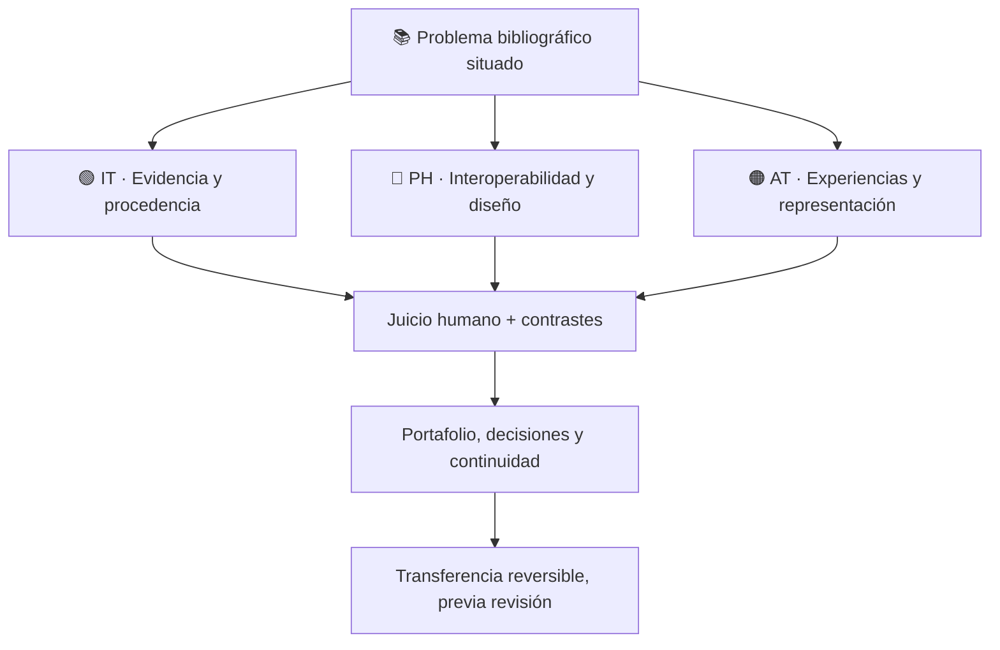
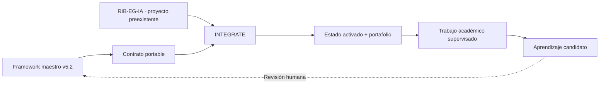
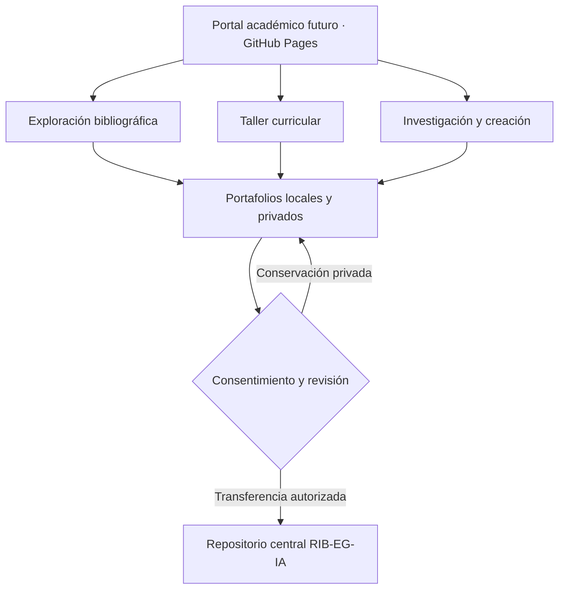

# 📚 RIB-EG-IA
## Repositorio Institucional de Colecciones Bibliográficas en Educación General e Inteligencia Artificial

**Conocimiento · patrimonio · investigación · aprendizaje · transferencia responsable**

> Una biblioteca es más que una lista de títulos: las fuentes adquieren valor cuando podemos interrogarlas, contextualizarlas, contrastarlas y volver sobre nuestras decisiones. RIB-EG-IA prepara ese espacio académico con apoyo de IA y juicio humano.

**Autor y responsable académico:** Ricardo Juan Morales De Jesús, Ph.D.  
**Departamento de Ciencias Físicas · Facultad de Estudios Generales · Universidad de Puerto Rico en Río Piedras**  
**Origen documental:** v0.3 · **Framework:** v5.2.0 · **Modo:** `INTEGRATE` / `preserve_source`  
**Estado (16-10-2026):** activación mínima registrada y respaldada; aplicación bibliográfica propia aún no desplegada.

> La identificación académica del autor no constituye aval institucional formal de la Universidad de Puerto Rico.

## 🚪 Cinco puertas para orientarse

| Quiero... | Empezar aquí |
|---|---|
| 🌱 **Comenzar el proyecto** | [Ficha de activación mínima](22_INTEGRATE_FRAMEWORK_V5_2/Activacion_Minima_RIB_EGIA_V5_2_2026-10-16.md) |
| ✅ **Verificar si está listo** | [Gate formal ACT-01](00_CONTROL_MAESTRO/04_Primers_Continuidad/GATE_ACT_CIERRE_Framework_V5_2_2026-10-16.md) |
| 🧳 **Examinar el paquete Framework** | [Instantánea JSON activada](22_INTEGRATE_FRAMEWORK_V5_2/Activacion_Framework_V5_2/project-package-activado.json) |
| 🧭 **Comprender el método** | [Framework Genérico v5.2](https://github.com/ricardojuanmorales/framework-proyecto-generico-ia-1) · [Aplicación V5](https://ricardojuanmorales.github.io/framework-proyecto-generico-ia-1/v5/) |
| 🕰️ **Reconstruir lo sucedido** | [Bitácora de cierre](00_CONTROL_MAESTRO/00_Bitacoras/Bitacora_Sesion_004_Cierre_INTEGRATE_Framework_V5_2_2026-10-15.md) · [Decisiones](00_CONTROL_MAESTRO/01_Decisiones/Registro_Decisiones_RIB_EGIA_v0_3.md) |

## 🧭 El problema está en el centro

**RIB-EG-IA** preserva y relaciona bibliografía generalizada y anotada, matrices de pensamiento transdisciplinario y asignaciones curriculares para la enseñanza, investigación y creación en Estudios Generales.

No es todavía una plataforma interactiva de consulta desplegada; hoy es **un repositorio académico estructurado y un proyecto Framework activado documentalmente**.



**Las lentes son capacidades complementarias, no profesiones obligatorias.** La combinación PH+IT+AT no constituye por sí sola una emergencia Caleidoscopio.

### 📖 Patrimonio con identidad propia

| Conjunto | Referencia documental | Precaución |
|---|---|---|
| **CAT** | 60 registros | No identificar automáticamente por código |
| **FIC** | 60 fichas anotadas | Revisar atribuciones y correspondencias |
| **MAT** | 60 entradas de matriz | Preservar relaciones originales |
| **CUR** | 150 asignaciones curriculares | No equivalen a 150 obras distintas |

Por ejemplo, `BA-004` presenta una colisión de identidad entre CAT y FIC. **Ninguna deduplicación o fusión automática está autorizada.** El patrimonio está conservado; la curaduría bibliográfica y la revisión de derechos continúan.

## 🧬 Cómo participa del Framework Genérico



- **START:** crea un proyecto nuevo.
- **INTEGRATE:** incorpora el Framework a un proyecto existente sin colonizar ni sobrescribir su estructura.
- **AUDIT:** contrasta estado y evidencia de un proyecto existente.
- **N3 de proyecto / N4 de autonomía declarada:** hipótesis de madurez, **no certificaciones**.
- **PORTAFOLIO:** memoria situada de evidencias, decisiones, reflexiones e invocaciones.
- **TSR:** transferencias documentadas y revisables; la equivalencia ampliada aplicación ↔ experto N3/N4 aún requiere ensayo.

El paquete original G2-R2 permanece como **evidencia histórica**; el archivo `project-package-activado.json` es la instantánea más reciente para la activación mínima. No debe interpretarse la aprobación en GitHub como prueba de despliegue o de importación nativa de esa nueva instantánea.

## 🧳 En qué fase estamos

| Hito | Estado |
|---|---|
| Conservación del patrimonio y correspondencias | ✅ Integrado, conflictos abiertos |
| Contratos portables y verificación nativa del candidato | ✅ 8 etapas PASS; Vitest 41/41 |
| Fusión controlada a GitHub `main` | ✅ Completada y respaldada |
| Activación mínima y ficha de continuidad | ✅ Registradas |
| Actualización del cartapacio local | ⏳ Verificar en VS Code |
| Importación funcional de la instantánea activada | ⏳ Aún no verificada |
| Aplicaciones bibliográficas y WordPress | 💤 No desplegadas |
| Diálogo N3/N4 profundo, Marco Mundi, TSR semántica | 📌 Deuda documentada, no bloqueante |

**Gate rector:** [ACT-01](00_CONTROL_MAESTRO/04_Primers_Continuidad/GATE_ACT_CIERRE_Framework_V5_2_2026-10-16.md). Su cierre completo exige la sincronización local y las comprobaciones señaladas, no nuevos cuestionarios.

## 🗺️ Estructura documental

La macroestructura oficial del Framework **00–21 + 99** está presente. `22_INTEGRATE_FRAMEWORK_V5_2/` es una extensión situada de RIB-EG-IA. No se replica automáticamente todo el código ni todos los contenidos del repositorio maestro.

| Cartapacio | Función |
|---|---|
| [`00_CONTROL_MAESTRO/`](00_CONTROL_MAESTRO/) | Gobernanza, bitácoras y decisiones |
| [`01_FUNDAMENTO_FILOSOFICO/`](01_FUNDAMENTO_FILOSOFICO/) | Pensamiento complejo y Estudios Generales |
| [`02_ARQUITECTURA_CONCEPTUAL/`](02_ARQUITECTURA_CONCEPTUAL/) | Modelos y relaciones |
| [`03_METODOLOGIA_Y_FLUJO_DE_TRABAJO/`](03_METODOLOGIA_Y_FLUJO_DE_TRABAJO/) | Metodología y ciclos |
| [`04_GOBERNANZA_ETICA_Y_RIESGOS/`](04_GOBERNANZA_ETICA_Y_RIESGOS/) | Derechos, riesgos y ética |
| [`05_COMPETENCIAS_Y_PERFILES/`](05_COMPETENCIAS_Y_PERFILES/) | PH, IT y AT |
| [`06_PASTILLAS_MODULARES/`](06_PASTILLAS_MODULARES/) | Recursos reutilizables |
| [`07_PLANTILLAS_Y_MODELOS/`](07_PLANTILLAS_Y_MODELOS/) | Plantillas bibliográficas |
| [`08_CURSOS_PROGRAMAS_Y_TRAYECTORIAS/`](08_CURSOS_PROGRAMAS_Y_TRAYECTORIAS/) | Trayectorias curriculares |
| [`09_IA_AGENTES_Y_COPILOTOS/`](09_IA_AGENTES_Y_COPILOTOS/) | Uso responsable de IA |
| [`10_REPOSITORIOS_Y_FLUJO_TECNICO/`](10_REPOSITORIOS_Y_FLUJO_TECNICO/) | GitHub, local, respaldos |
| [`11_MULTIMODALIDAD_Y_PUBLICACION/`](11_MULTIMODALIDAD_Y_PUBLICACION/) | Publicación proyectada |
| [`12_DISENO_INSTRUCCIONAL_UNIVERSAL/`](12_DISENO_INSTRUCCIONAL_UNIVERSAL/) | DUA, accesibilidad |
| [`13_INVESTIGACION_Y_EVIDENCIA/`](13_INVESTIGACION_Y_EVIDENCIA/) | Fuentes y trazabilidad |
| [`14_COMUNIDAD_TRANSFERENCIA_Y_ESCALAMIENTO/`](14_COMUNIDAD_TRANSFERENCIA_Y_ESCALAMIENTO/) | Colaboración y transferencia |
| [`15_EVALUACION_CALIDAD_Y_AUDITORIA/`](15_EVALUACION_CALIDAD_Y_AUDITORIA/) | Evaluación y auditoría |
| [`16_SEGURIDAD_PRIVACIDAD_Y_DATOS/`](16_SEGURIDAD_PRIVACIDAD_Y_DATOS/) | Privacidad y protección |
| [`17_INTERNACIONALIZACION_LOCALIZACION/`](17_INTERNACIONALIZACION_LOCALIZACION/) | Contextos y adaptación |
| [`18_DOCUMENTACION_ACTIVA/`](18_DOCUMENTACION_ACTIVA/) | Continuidad documental |
| [`19_IMPLEMENTACION_Y_DESPLIEGUE/`](19_IMPLEMENTACION_Y_DESPLIEGUE/) | Software y despliegue futuro |
| [`20_MANTENIMIENTO_Y_EVOLUCION/`](20_MANTENIMIENTO_Y_EVOLUCION/) | Evolución |
| [`21_WIKI_DOCUMENTACION_HUMANA/`](21_WIKI_DOCUMENTACION_HUMANA/) | Guías de uso |
| [`22_INTEGRATE_FRAMEWORK_V5_2/`](22_INTEGRATE_FRAMEWORK_V5_2/) | Extensión propia, activación y paquete |
| [`99_ARCHIVO_HISTORICO/`](99_ARCHIVO_HISTORICO/) | Versiones previas |

> La estructura es una brújula, no una orden de llenar todos los cartapacios antes de actuar.

## 🖥️ Trabajo local con VS Code

**Clon nuevo (solo si todavía no existe):**

```bash
cd ~/Documents
git clone https://github.com/ricardojuanmorales/repositorio-institucional-eg-ia-1.git
cd repositorio-institucional-eg-ia-1
code .
```

**Clon existente:** abre su carpeta en VS Code y, en la terminal integrada, comprueba `git status --short` y `git remote -v`. Si no hay cambios locales que debas proteger, ejecuta `git pull --ff-only origin main`. No uses `git reset --hard`, `git clean -fd` ni `git push --force` para sincronizar.

El Gate se encuentra en `00_CONTROL_MAESTRO/04_Primers_Continuidad/`. El hecho de que la rama remota esté actualizada **no verifica el estado del cartapacio en una computadora particular**.

## 🎓 Del repositorio al laboratorio vivo

El primer uso previsto es **consulta y curaduría bibliográfica académica supervisada**. Posteriormente podrán surgir aplicaciones de exploración, investigación-creación, trayectorias curriculares y portafolios reflexivos.

- **[AI StoryLab 1](https://github.com/ricardojuanmorales/ai-storylab-1):** referencia de SDD, local-first, seguridad por diseño, recuperación, pruebas y CI/CD.
- **[Materia Mundi](https://ricardojuanmorales.github.io/materia-mundi-101/):** referencia de portal con acceso a aplicaciones modulares.
- **Marco Mundi:** propuesta de marco pedagógico transversal, contextualizable e invocable, **sin activación automática** ni rango de cuarto perfil.



*Diagrama conceptual: esas aplicaciones y la sincronización de portafolios no están implementadas todavía.* GitHub Pages no equivale a un servicio de almacenamiento privado o autenticación.

## 🛡️ Gobernanza, autoría y memoria

```text
Framework → estructura
IA        → propone y contrasta
Máquina   → ejecuta y evidencia
Humano    → comprende, decide, autoriza y responde
```

Se preservan los originales, las decisiones y la incertidumbre. La información privada no se publica automáticamente. Las contribuciones al canon Framework exigen revisión independiente.

**Historial de integración:** [commit de INTEGRATE](https://github.com/ricardojuanmorales/repositorio-institucional-eg-ia-1/commit/7b347d1799c763ded55b187cf493b608a39da540) · [rama de respaldo anterior](https://github.com/ricardojuanmorales/repositorio-institucional-eg-ia-1/tree/backup/pre-integrate-v0.3-20261015) · [registro de release REL-002](00_CONTROL_MAESTRO/03_Releases/REL-002_INTEGRATE_Framework_V5_2_2026-10-15.md).

**Ricardo Juan Morales De Jesús, Ph.D.**  
Departamento de Ciencias Físicas · Facultad de Estudios Generales · Universidad de Puerto Rico en Río Piedras.

La IA ha asistido en revisión técnica, pruebas, organización y redacción bajo responsabilidad humana. Las referencias, derechos de uso y autorizaciones institucionales requieren sus verificaciones correspondientes.

---

*README de orientación para el usuario ilustrado. Revisión editorial del 16 de octubre de 2026. Las figuras Mermaid son mapas explicativos y no sustituyen la arquitectura canónica del Framework.*
