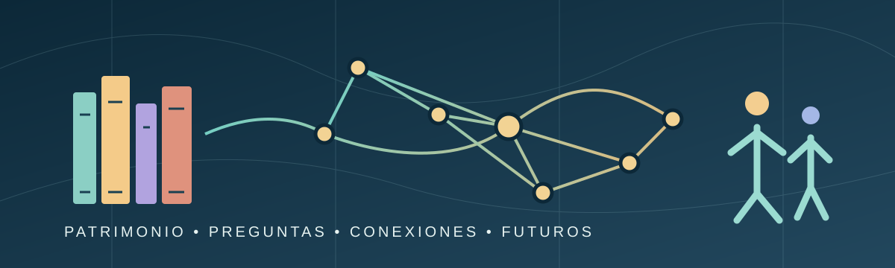
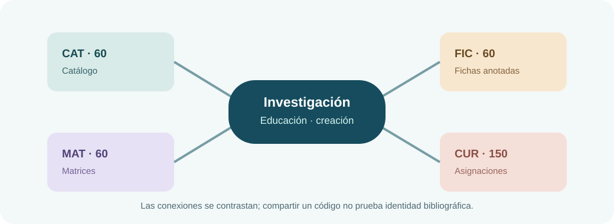
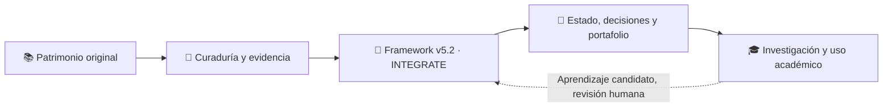
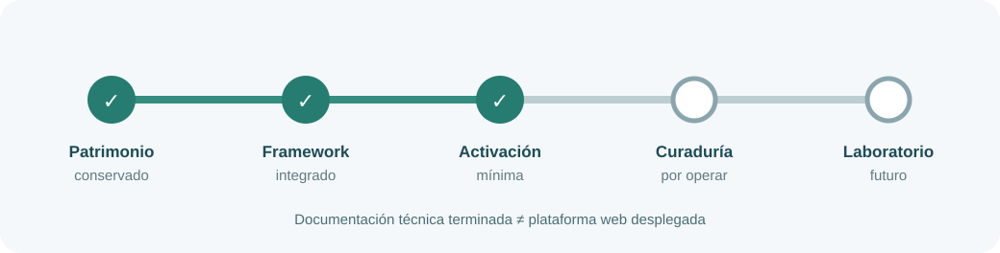
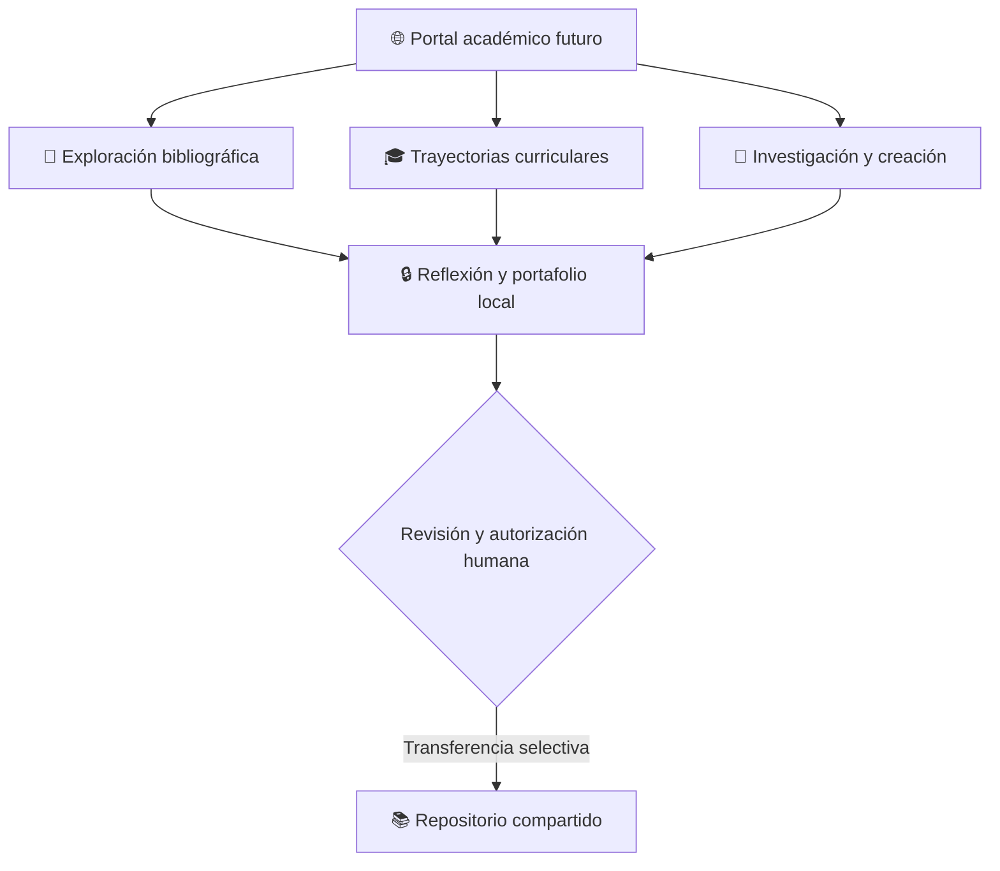

# 📚 RIB-EG-IA
## Un patrimonio bibliográfico para pensar, investigar, enseñar y crear



**Colecciones · pensamiento transdisciplinario · Estudios Generales · inteligencia artificial responsable**

> Las bibliografías son mapas de conversaciones humanas. Este proyecto procura conservar sus fuentes, revelar relaciones, reconocer incertidumbres y facilitar nuevas preguntas desde la educación general.

Bienvenidos al **Repositorio Institucional de Colecciones Bibliográficas en Educación General e Inteligencia Artificial (RIB-EG-IA)**. Es una iniciativa académica de documentación, investigación y curaduría bibliográfica que trabaja con el [Framework Genérico v5.2.0](https://github.com/ricardojuanmorales/framework-proyecto-generico-ia-1).

**Responsable académico:** Ricardo Juan Morales De Jesús, Ph.D.  
**Adscripción:** Departamento de Ciencias Físicas, Facultad de Estudios Generales, Universidad de Puerto Rico en Río Piedras.  
**Situación documentada (16 de octubre de 2026):** patrimonio preservado, integración técnica Framework completada y activación mínima registrada. **La plataforma bibliográfica interactiva todavía no está desplegada.**

*Esta identificación académica no constituye por sí sola aprobación institucional de la Universidad de Puerto Rico.*

## 🚪 Elige tu puerta de entrada

| Tu interés | Comienza aquí |
|---|---|
| 🌱 **Descubrir el proyecto** | [Propósito y patrimonio](#-una-ecología-de-colecciones) |
| 🔎 **Explorar cómo trabajamos** | [Investigación, tres lentes y curaduría](#-del-documento-a-la-pregunta) |
| 🧭 **Comprender la arquitectura** | [Framework y organización](#-una-arquitectura-que-conserva-memoria) |
| 📍 **Conocer el estado real** | [Avances y próximos horizontes](#-dónde-estamos-hoy) |
| 🤝 **Orientarte para colaborar** | [Documentación y rutas de acceso](#-rutas-para-participar) |

## 🌱 ¿Por qué existe?

En Educación General, una obra rara vez vive en una sola disciplina: puede dialogar con ciencia, historia, filosofía, arte, tecnología y vida pública. El proyecto busca que esa riqueza no se pierda entre documentos aislados.

**Nuestro propósito** es organizar, preservar, relacionar y desarrollar colecciones bibliográficas para apoyar la enseñanza, la investigación y la creación transdisciplinaria. La IA puede asistir en organización y contraste, pero las decisiones bibliográficas, editoriales y de publicación permanecen bajo responsabilidad humana.

### Cuatro escenas del proyecto

1. **Una fuente llega con historia.** Se conservan sus datos y procedencia, incluso cuando existen incertidumbres.
2. **Una pregunta abre conexiones.** La obra dialoga con otros registros, unidades curriculares y enfoques disciplinares.
3. **Las interpretaciones se contrastan.** Las coincidencias de identificadores no se confunden con pruebas de identidad.
4. **La memoria permanece disponible.** Evidencias y decisiones pueden revisarse y transferirse con autorización.

## 📚 Una ecología de colecciones



| Conjunto | Contenido documental | Magnitud |
|---|---|---:|
| **CAT** | Entradas de catálogo | 60 |
| **FIC** | Fichas de bibliografía anotada | 60 |
| **MAT** | Registros y relaciones de matriz | 60 |
| **CUR** | Asignaciones curriculares distribuidas en cinco unidades | 150 |

**150 asignaciones CUR no son necesariamente 150 obras únicas.** Los conjuntos mantienen identidades separadas hasta verificar sus correspondencias. Un ejemplo de discrepancia es `BA-004`, código que puede referir a obras diferentes en CAT y FIC. No se autorizan fusiones automáticas.

La documentación actual conserva los originales y registra correspondencias candidatas para curaduría posterior. No afirma que todos los metadatos, citas o derechos hayan sido verificados.

## 🔭 Del documento a la pregunta

El repositorio dialoga con las tres lentes del Framework:

| Lente | Pregunta que aporta |
|---|---|
| 🔵 **PH · Programador Humanista** | ¿Cómo preservar, conectar y presentar el conocimiento responsablemente? |
| 🟢 **IT · Investigador Transdisciplinario** | ¿Qué sabemos de una fuente y con qué evidencia lo afirmamos? |
| 🟠 **AT · Artista Transdisciplinario** | ¿Qué experiencias y representaciones permiten percibir otras relaciones? |

No son tres profesiones rígidas ni tres formularios obligatorios. La interacción entre lentes puede abrir posibilidades nuevas, pero **no constituye automáticamente una emergencia Caleidoscopio**.

**Marco Mundi**, propuesta de marco pedagógico transversal e invocable, podrá orientar futuras experiencias de indagación y aprendizaje. Su desarrollo profundo está diferido y no bloquea el trabajo académico básico.

## 🧬 Una arquitectura que conserva memoria

RIB-EG-IA es un **proyecto preexistente incorporado mediante INTEGRATE**, sin sustituir su historia por la del Framework.



**La integración técnica está completada y respaldada.** El Framework estructura continuidad, perfiles, decisiones y transferencias; el proyecto conserva su identidad académica. La madurez del proyecto está declarada en **N3** y la autonomía en **N4 declarada**, lo cual **no constituye una certificación empírica automática**.

### El cuerpo documental del proyecto

La macroestructura `00–21 + 99` sigue la del Framework maestro. El cartapacio `22_INTEGRATE_FRAMEWORK_V5_2/` es una extensión particular de RIB-EG-IA.

| Cartapacios | Qué permiten encontrar |
|---|---|
| [`00_CONTROL_MAESTRO/`](00_CONTROL_MAESTRO/) | Bitácoras, decisiones, gates y continuidad |
| [`01_FUNDAMENTO_FILOSOFICO/`](01_FUNDAMENTO_FILOSOFICO/) a [`05_COMPETENCIAS_Y_PERFILES/`](05_COMPETENCIAS_Y_PERFILES/) | Fundamentos, arquitectura, métodos, ética y lentes |
| [`06_PASTILLAS_MODULARES/`](06_PASTILLAS_MODULARES/) a [`12_DISENO_INSTRUCCIONAL_UNIVERSAL/`](12_DISENO_INSTRUCCIONAL_UNIVERSAL/) | Recursos, cursos, IA, procesos técnicos, publicación y accesibilidad |
| [`13_INVESTIGACION_Y_EVIDENCIA/`](13_INVESTIGACION_Y_EVIDENCIA/) a [`17_INTERNACIONALIZACION_LOCALIZACION/`](17_INTERNACIONALIZACION_LOCALIZACION/) | Bibliografía, evidencia, comunidad, evaluación, datos y contextos |
| [`18_DOCUMENTACION_ACTIVA/`](18_DOCUMENTACION_ACTIVA/) a [`21_WIKI_DOCUMENTACION_HUMANA/`](21_WIKI_DOCUMENTACION_HUMANA/) | Documentación, implementación, evolución y orientación |
| [`22_INTEGRATE_FRAMEWORK_V5_2/`](22_INTEGRATE_FRAMEWORK_V5_2/) | Paquetes portables y activación |
| [`99_ARCHIVO_HISTORICO/`](99_ARCHIVO_HISTORICO/) | Continuidad histórica y versiones anteriores |

La estructura guía, pero no obliga a completar cada cartapacio antes de iniciar trabajo significativo.

## 📍 ¿Dónde estamos hoy?



| Dimensión | Estado verificable |
|---|---|
| Preservación bibliográfica original | **Realizada** |
| Integración documental/técnica en GitHub | **Realizada**, con respaldo histórico |
| Validación técnica del candidato | **8/8 etapas PASS, Vitest 41/41**, según expediente de integración |
| Activación mínima Framework v5.2 | **Registrada** |
| Curaduría bibliográfica académica como operación continua | **Siguiente bloque** |
| Plataforma interactiva y WordPress | **No desplegadas** |
| Laboratorio multiaplicación y equivalencia dialógica N3/N4 | **Horizonte de desarrollo e investigación** |

La nueva instantánea de activación tiene estado `active` en el paquete documental. Su importación funcional específica y el cierre de la sincronización local deben verificarse por separado según el [Gate ACT-01](00_CONTROL_MAESTRO/04_Primers_Continuidad/GATE_ACT_CIERRE_Framework_V5_2_2026-10-16.md).

### Lo que aspiramos a construir

Un entorno académico donde docentes, estudiantes e investigadores puedan consultar colecciones, interpretar relaciones, producir materiales y conservar sus trayectorias de aprendizaje. Las aplicaciones futuras se inspiran en las prácticas de [AI StoryLab 1](https://github.com/ricardojuanmorales/ai-storylab-1) y en el portal [Materia Mundi](https://ricardojuanmorales.github.io/materia-mundi-101/).



*Este diagrama expresa una visión, no funcionalidades publicadas.*

## 🤝 Rutas para participar

Puedes entrar por una obra, una pregunta de investigación, un problema de clasificación, una actividad de enseñanza o una crítica documentada. No es necesario dominar todo el Framework para comenzar a colaborar de forma responsable.

- **Para comprender el marco rector:** [Framework Genérico v5.2.0](https://github.com/ricardojuanmorales/framework-proyecto-generico-ia-1).
- **Para revisar la historia del proyecto:** [bitácora de cierre INTEGRATE](00_CONTROL_MAESTRO/00_Bitacoras/Bitacora_Sesion_004_Cierre_INTEGRATE_Framework_V5_2_2026-10-15.md).
- **Para examinar el estado portable:** [paquete de activación mínima](22_INTEGRATE_FRAMEWORK_V5_2/Activacion_Framework_V5_2/project-package-activado.json).
- **Para verificar el alcance y las limitaciones:** [Gate ACT-01](00_CONTROL_MAESTRO/04_Primers_Continuidad/GATE_ACT_CIERRE_Framework_V5_2_2026-10-16.md).
- **Para conservar la memoria editorial:** [README anterior archivado](99_ARCHIVO_HISTORICO/04_Exportaciones/README_RIB_EGIA_Anterior_2026-10-16.md).

## 🌿 Un compromiso de conocimiento responsable

```text
Fuentes y comunidades → preguntas y evidencia
Framework            → estructura y continuidad
IA                   → análisis y alternativas
Máquina              → ejecución y trazabilidad
Humano               → interpretación, autorización y responsabilidad
```

**El repositorio preserva memoria, no certifica automáticamente conocimiento.** Una correspondencia provisional no es una identidad bibliográfica confirmada; una aplicación planificada no es un servicio operativo; y un aporte no adquiere autoridad canónica sin contraste y revisión.

---

**Ricardo Juan Morales De Jesús, Ph.D.**  
Departamento de Ciencias Físicas · Facultad de Estudios Generales · Universidad de Puerto Rico en Río Piedras.

*Portada pública de orientación. Actualización editorial: 16 de octubre de 2026. Ilustraciones SVG originales para este README, de carácter explicativo; no sustituyen documentos canónicos ni representan servicios ya desplegados.*
